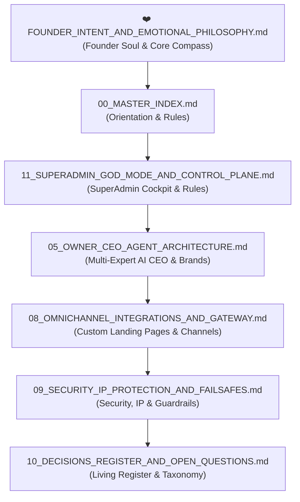

# 📚 Vismart AI SaaS — Master Knowledge Base & Vision Index

> [!IMPORTANT]
> **MANDATORY READING RULE FOR ALL AI AGENTS & ENGINEERS:**  
> Before generating code, proposing architectural changes, or designing business workflows, every agent or engineer MUST review this Knowledge Base. It defines the permanent founder philosophy, change-safe architecture, security boundaries, and modular service specifications.

---

## 🧭 Executive Summary

**Vismart AI SaaS** is not a simple chatbot, dumb auto-responder, or rigid CRM.  
It is a **Full-Stack Autonomous AI Agent Creation, Learning, Automation & Operating Platform** built on the principles of **Dharmic/Ethical Business, Relational Growth Partnership, Flexible SuperAdmin Control, and Change-Safe Modular Architecture**.

The system empowers solo creators, growing businesses, and large B2B manufacturers to build, train, deploy, and monitor goal-driven AI workforces across **WhatsApp Cloud API, Web Chat Widgets, Custom Domains, and Omnichannel Integrations**.

---

## 📑 Master Document Registry

| # | Document | File Path | Core Scope & Purpose | Status |
|---|---|---|---|---|
| **❤️** | **Founder Intent & Soul** | [`docs/vision/FOUNDER_INTENT_AND_EMOTIONAL_PHILOSOPHY.md`](file:///C:/Users/hp/.gemini/antigravity/scratch/wacrm/docs/vision/FOUNDER_INTENT_AND_EMOTIONAL_PHILOSOPHY.md) | Founder's personal emotions, core purpose, AI partner ethos, and unchanging soul. | `Founder Confirmed` |
| **00** | **Master Index** | [`docs/vision/00_MASTER_INDEX.md`](file:///C:/Users/hp/.gemini/antigravity/scratch/wacrm/docs/vision/00_MASTER_INDEX.md) | Central repository navigation, reading sequences, and doc taxonomy. | `Founder Confirmed` |
| **01** | **Platform Identity & Philosophy** | [`docs/vision/01_PLATFORM_IDENTITY_AND_PHILOSOPHY.md`](file:///C:/Users/hp/.gemini/antigravity/scratch/wacrm/docs/vision/01_PLATFORM_IDENTITY_AND_PHILOSOPHY.md) | Platform mission, Dharmic ethics, Growth Partner philosophy (*"Grahak kamayega to hum kamayenge"*). | `Founder Confirmed` |
| **02** | **User Personas & Market Tiers** | [`docs/vision/02_USER_PERSONAS_AND_MARKET_TIERS.md`](file:///C:/Users/hp/.gemini/antigravity/scratch/wacrm/docs/vision/02_USER_PERSONAS_AND_MARKET_TIERS.md) | Multi-tier customer segments (B2B Manufacturers, Solo/Creator, SMB, Enterprise, Agency). | `Founder Confirmed` |
| **03** | **Conversational Studio & Agent Factory** | [`docs/vision/03_CONVERSATIONAL_STUDIO_AND_AGENT_FACTORY.md`](file:///C:/Users/hp/.gemini/antigravity/scratch/wacrm/docs/vision/03_CONVERSATIONAL_STUDIO_AND_AGENT_FACTORY.md) | Chat-first Agent Studio, Pre-built AI Archetypes (B2B Quote Closer, Support, Supervisor). | `Founder Confirmed` |
| **04** | **Memory, Learning & Tenant Privacy** | [`docs/vision/04_MEMORY_LEARNING_AND_TENANT_PRIVACY.md`](file:///C:/Users/hp/.gemini/antigravity/scratch/wacrm/docs/vision/04_MEMORY_LEARNING_AND_TENANT_PRIVACY.md) | Episodic/Semantic memory, pgvector RAG, strict tenant isolation, privacy firewalls. | `Founder Confirmed` |
| **05** | **Private Founder AI CEO Architecture** | [`docs/vision/05_OWNER_CEO_AGENT_ARCHITECTURE.md`](file:///C:/Users/hp/.gemini/antigravity/scratch/wacrm/docs/vision/05_OWNER_CEO_AGENT_ARCHITECTURE.md) | Founder's Multi-Expert AI Chief of Staff (5 Personas), Multi-Brand Vertical Spawner. | `Founder Confirmed` |
| **06** | **Permissions, Autonomy & Approvals** | [`docs/vision/06_PERMISSIONS_AUTONOMY_AND_APPROVALS.md`](file:///C:/Users/hp/.gemini/antigravity/scratch/wacrm/docs/vision/06_PERMISSIONS_AUTONOMY_AND_APPROVALS.md) | 7-Tier Autonomy Matrix, One-line Founder Approval UI, Action Ledger & Audit. | `Founder Confirmed` |
| **07** | **Billing Economics, Wallet & Margins** | [`docs/vision/07_BILLING_ECONOMICS_AND_WALLET.md`](file:///C:/Users/hp/.gemini/antigravity/scratch/wacrm/docs/vision/07_BILLING_ECONOMICS_AND_WALLET.md) | High-ticket B2B retainers, prepaid transparent wallet, real-time token/Meta cost tracking. | `Technical Recommendation` |
| **08** | **Omnichannel Integrations & Gateway** | [`docs/vision/08_OMNICHANNEL_INTEGRATIONS_AND_GATEWAY.md`](file:///C:/Users/hp/.gemini/antigravity/scratch/wacrm/docs/vision/08_OMNICHANNEL_INTEGRATIONS_AND_GATEWAY.md) | WhatsApp WACA, Dynamic Custom Landing Pages (`chat.brand.com`), Google Sync. | `Founder Confirmed` |
| **09** | **Security, IP Protection & Failsafes** | [`docs/vision/09_SECURITY_IP_PROTECTION_AND_FAILSAFES.md`](file:///C:/Users/hp/.gemini/antigravity/scratch/wacrm/docs/vision/09_SECURITY_IP_PROTECTION_AND_FAILSAFES.md) | Core IP Shield (Prompt masking), RLS security, Dharmic ethical filter, Kill-switches. | `Founder Confirmed` |
| **10** | **Decisions Register & Open Questions** | [`docs/vision/10_DECISIONS_REGISTER_AND_OPEN_QUESTIONS.md`](file:///C:/Users/hp/.gemini/antigravity/scratch/wacrm/docs/vision/10_DECISIONS_REGISTER_AND_OPEN_QUESTIONS.md) | Master Living Register: Approved decisions, active proposals, and pending tradeoffs. | `Founder Confirmed` |
| **11** | **SuperAdmin God-Mode & Control Plane** | [`docs/vision/11_SUPERADMIN_GOD_MODE_AND_CONTROL_PLANE.md`](file:///C:/Users/hp/.gemini/antigravity/scratch/wacrm/docs/vision/11_SUPERADMIN_GOD_MODE_AND_CONTROL_PLANE.md) | 7 SuperAdmin Control Modules: AI Command Bar, Impersonation, Dynamic Pricing, Live Profit Meter. | `Founder Confirmed` |

---

## 🎯 Recommended Reading Sequence for Agents & Developers

