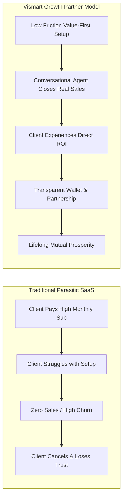

# 🕊️ 01. Platform Identity, Operating Philosophy & Growth Partner Ethos

> *"हम सिर्फ एक सॉफ्टवेयर बेचने वाली कंपनी नहीं हैं। हम हर व्यापारी और क्रिएटर के सच्चे ग्रोथ पार्टनर हैं। जब हमारा ग्राहक कमाएगा, खुशहाल होगा, तभी हमारी वास्तविक कमाई होगी।"*  
> — **फाउंडर, Vismart AI SaaS** [Founder Confirmed]

---

## 🌟 1. Core Platform Identity [Founder Confirmed]

Vismart AI SaaS is **not** a standard chatbot, an off-the-shelf CRM, or a simple auto-responder.

### What Vismart AI SaaS IS:
1. **Autonomous AI Workforce Platform:** A system that provides specialized, intelligent AI agents capable of closing sales, answering inquiries, nurturing leads, and coordinating operations.
2. **AI Agent Creation & Learning Studio:** A conversational environment where any non-technical business owner can create, train, test, and control AI agents purely through natural conversation.
3. **Relational Growth Partner:** A platform that builds genuine, long-term relationships with customers, focusing on their real business growth, personal happiness, and societal wellbeing.
4. **Change-Safe, Modular SaaS:** `[Technical Recommendation]` An architecture where business logic, pricing, models, channels, and workflows are decoupled and configurable without rewriting code.

### What Vismart AI SaaS is NOT:
- ❌ An unofficial scraper or spam engine (strictly using Official WhatsApp Cloud API).
- ❌ A rigid decision-tree bot that frustrates customers with robotic menus ("Press 1 for Sales").
- ❌ A parasitic tool that charges high monthly fees while delivering zero customer sales.
- ❌ An opaque black-box AI where the owner has no visibility or sovereign control.

---

## 🕉️ 2. Core Ethics & Values [Founder Confirmed]

Vismart is built on the principles of **Truth (Satya), Fairness (Nyaya), Societal Wellbeing (Lokasamgraha), and Human Dignity**:

### A. Honest Commerce & Genuine Value Addition
- **Truth in Sales:** AI agents must never deceive customers, make false promises, or invent fake discounts.
- **Fair Accounting:** Transparent billing where every token, message, and markup is crystal clear. Zero hidden fees.
- **Human Liberation:** Automation is deployed to liberate business owners from repetitive routine chores so they can focus on higher vision, family, health, and good deeds.

### B. Prohibited Harmful Categories `[Proposed / Founder Guideline]`
In alignment with ethical principles, Vismart prohibits deployments in harmful verticals:
1. **Slaughter / Meat / Fish Promotion & Trade** (Non-violence / Ahimsa ethos).
2. **Gambling, Betting & Speculative Scams.**
3. **Narcotics, Intoxicants & Harmful Substances.**
4. **Deceptive Financial Schemes & Exploitative Systems.**

---

## 🤝 3. The "Growth Partner" Philosophy (*Grahak Kamayega to Hum Kamayenge*) [Founder Confirmed]

Traditional SaaS companies charge high upfront recurring fees whether the client succeeds or fails. Vismart flips this paradigm:

### Core Tenets:
- **Value-First Alignment:** Prove real business results before asking for heavy financial commitments.
- **Revenue-Attributed Success:** Help clients clearly see how many real leads and sales were handled by their AI.
- **Transparent Wallet Economics:** Pay-per-use AI tokens and WhatsApp messages with zero hidden markups.

---

## 💖 4. Relational Intelligence & Empathy [Founder Confirmed]

A customer is not just a phone number or ticket ID:
- **Empathetic Context:** Remembering customer preferences, city, family milestones, and cultural celebrations.
- **Community Wellbeing:** Periodically understanding if the business owner or customer is facing genuine hurdles and offering supportive assistance.
- **Dignity & Respect:** Treating every customer with warmth, politeness, and sincere service.
