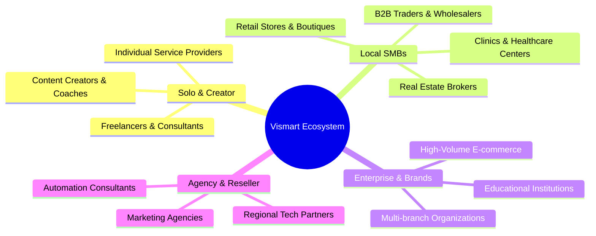
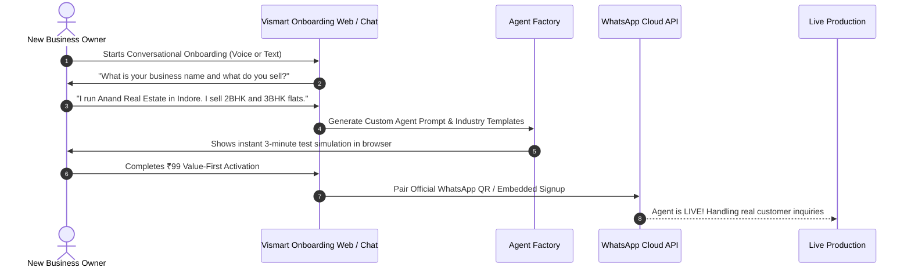

# 👥 02. User Personas, Market Tiers & Customer Journeys

This document defines the target customer personas, their operational pain points, market tier entitlements, and tailored user journeys in Vismart AI SaaS.

---

## 🎯 1. Target User Personas

### Persona A: The Solo Creator / Freelance Consultant
- **Profile:** Individuals handling incoming client inquiries, calendar scheduling, quote generation, and portfolio distribution via WhatsApp and personal website.
- **Pain Point:** Answering repetitive questions at midnight; losing leads while working on client deliverables.
- **Vismart Solution:** A conversational personal AI assistant that answers FAQs, shares past work, qualifies client budgets, books Google Calendar slots, and collects initial deposits via payment links.

### Persona B: The Growing SMB (Real Estate, Retail, Coaching, Clinics)
- **Profile:** 5 to 50 team members; receives 50 to 500 WhatsApp chats daily from Facebook/Instagram ads or local footfall.
- **Pain Point:** Slow response times causing lead leakage; staff forgetting follow-ups; inability to remember past customer conversations.
- **Vismart Solution:** Pre-configured Industry Agent Packs (e.g., Real Estate Property Closer, Coaching Admission Counselor) with pgvector deep memory, automated 2-day nurturing follow-ups, and instant Razorpay/UPI payment links.

### Persona C: High-Volume Enterprise & Multi-Branch Brands
- **Profile:** Handles thousands of conversations daily across multiple departments (Sales, Billing, Technical Support, Escalations).
- **Pain Point:** High agent overhead; lack of quality consistency; data privacy concerns; complex multi-number management.
- **Vismart Solution:** Multi-agent supervisor routing, strict Row-Level Security (RLS), multi-WABA (WhatsApp Business Account) routing, dedicated audit logs, and custom web chat widget embed.

### Persona D: Agency & Reseller Partners
- **Profile:** Digital marketing agencies setting up marketing funnels and automation for their own local clients.
- **Pain Point:** Lack of white-label AI infrastructure; difficulty charging recurring maintenance fees.
- **Vismart Solution:** Multi-tenant agency workspaces, custom domain mapping, sub-account creation, and margin-based revenue models.

---

## 📊 2. Market Tier & Feature Entitlements Matrix

| Feature / Capability | Solo Starter (₹99 Trial / Lite) | Growth SMB | Business Pro | Enterprise / Agency |
|---|---|---|---|---|
| **Target Audience** | Creators & Solo Freelancers | Local Shops & Clinics | Growing SMBs & Real Estate | High-Volume Brands & Agencies |
| **Connected Channels** | 1 WhatsApp / 1 Web Widget | 1 WhatsApp + 1 Web Widget | 2 WhatsApp + Unlimited Web | Multi-WABA + Custom Domains |
| **Active AI Agents** | 1 Single General Agent | Up to 3 Specialized Agents | Up to 10 Agents + Supervisor | Unlimited Agents + Custom Code |
| **Episodic Memory Window** | 30 Days (100 Vector chunks) | 1 Year (1,000 Vector chunks) | 3 Years (10,000 Vector chunks) | Infinite Memory & Dedicated DB |
| **Follow-up / Broadcast** | Manual triggers only | Automated 3-stage drip | Smart AI Opportunity Engine | Full Cron & Predictive Broadcast |
| **Payment Integration** | Razorpay Payment Links | Razorpay + UPI QR | Multiple Gateways + Auto-settle | Custom Webhook & ERP Sync |
| **Human Takeover** | Basic WhatsApp alert | Live Dashboard Takeover | Team Inbox & Agent Assign | Advanced Round-robin & SLAs |
| **Support SLA** | Community / AI Support | Priority Email & WhatsApp | Dedicated Account Manager | 24/7 Phone & Custom SLA |

---

## 🚀 3. The 3-Step "Frictionless" Customer Journey

1. **Discovery & Natural Interview:** The owner doesn't fill out a 50-field form. The AI conducts a friendly 3-minute conversation asking about products, prices, target audience, and policies.
2. **Instant Agent Synthesis:** The Agent Factory instantly builds the knowledge base, vector embeddings, system prompts, and action tools.
3. **Frictionless QR Connection:** Connects official WhatsApp Business number in seconds with zero technical complexity.
