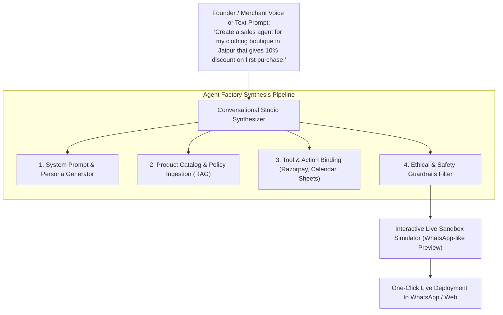
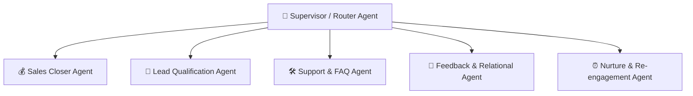

# 🏭 03. Conversational Agent Studio & Agent Factory Architecture

This document details the Conversational Agent Creation Studio, prompt-to-agent synthesis engine, pre-built specialized AI archetypes, and multi-agent coordination workflows.

---

## 🎙️ 1. Conversational Agent Studio (No-Code Builder)

Instead of forcing users to configure complex JSON schemas or wiring node graphs, Vismart provides a **Chat-First & Voice-First Agent Studio**.

### Studio Capabilities:
1. **Natural Language Persona Formulation:** Define agent behavior, tone (e.g. *"Respectful, warm, Rajasthani Hindi-English mix"*), and sales targets simply by talking to the Studio AI.
2. **Instant Document & Link Ingestion:** Drag and drop PDFs, product brochures, price lists, or paste website URLs. The studio chunks and indexes them into vector embeddings automatically.
3. **Interactive Side-by-Side Simulation:** Test the agent in a simulated WhatsApp window immediately before going live.
4. **Autonomous Prompt Refinement:** The studio observes test dialogues and suggests improvements (e.g., *"Agent was too quick to offer a 10% discount; should we ask for their order size first?"*).

---

## 🤖 2. Pre-Built Agent Factory Archetypes

Vismart ships with a rich library of pre-tuned, battle-tested agent archetypes ready for 1-click deployment:

### 1. The Sales Closer Agent (*Munim Ji / Closer*)
- **Objective:** Convert interested prospects into paying customers.
- **Key Capabilities:**
  - Dynamic objection handling (pricing, competitor comparisons, delivery times).
  - Razorpay / UPI dynamic payment link generation with exact item totals.
  - Guardrailed discount negotiation (e.g., max 10% discount only if cart > ₹2,000).
  - Scarcity and urgency presentation without deception.

### 2. The Lead Generation & Qualification Agent (*Parakh AI*)
- **Objective:** Filter tire-kickers and extract actionable lead parameters.
- **Key Capabilities:**
  - Automated budget, timeline, and requirement qualification.
  - Calculation of dynamic `lead_score` (0–100) and `lifecycle_stage`.
  - Instant Google Sheet sync and High-Priority CRM alert to human sales reps.

### 3. The Customer Support & Order Status Agent (*Sahayak AI*)
- **Objective:** 24/7 instant resolution of repetitive queries.
- **Key Capabilities:**
  - Live order tracking and delivery status lookup.
  - Return / refund policy explanation and ticket creation.
  - Multi-language translation across 12+ Indian languages.

### 4. The Feedback, Survey & Community Connection Agent (*Mitra AI*)
- **Objective:** Build relational warmth, collect reviews, and celebrate cultural milestones.
- **Key Capabilities:**
  - Post-purchase satisfaction surveys and Net Promoter Score (NPS) recording.
  - Sending personalized, warm greetings on major festivals (Diwali, Eid, Holi) and customer birthdays/anniversaries.
  - Collecting qualitative feedback on product quality and merchant service.

### 5. The Automated Nurturing & Follow-Up Engine (*Sanjivani Engine*)
- **Objective:** Recover abandoned inquiries and stalled deals.
- **Key Capabilities:**
  - Scheduled WACA template triggers (e.g., 2 hours, 24 hours, or 48 hours post-inquiry).
  - Contextual reactivation messages referencing the exact product the customer viewed.
  - Smart frequency capping to prevent spamming.

### 6. The Supervisor & Quality Orchestrator Agent (*Pradhan AI*)
- **Objective:** Monitor sub-agent conversations, enforce tone compliance, and handle live escalation.
- **Key Capabilities:**
  - Real-time sentiment analysis; detects customer frustration or anger.
  - Instant graceful transfer to human agents with a concise executive handoff summary.
  - Audit logging of sub-agent compliance with ethical guidelines.

---

## 🧰 3. Standard Agent Tool Registry

Every agent in the Factory has access to standardized, sandboxed tools:

| Tool Identifier | Description | Safety & Authorization Level |
|---|---|---|
| `generate_payment_link` | Creates dynamic Razorpay / Cashfree / Stripe payment link with itemized breakdown. | `PREAUTHORIZED` (Within merchant limit) |
| `book_calendar_slot` | Checks live availability and books Google Calendar / Cal.com meeting. | `PREAUTHORIZED` |
| `fetch_order_status` | Queries database / Shopify / WooCommerce for real-time delivery state. | `READ_ONLY` |
| `apply_custom_discount` | Applies special discount code or price reduction. | `POLICY_BOUND` (Max capped %) |
| `request_human_takeover`| Pauses AI session and sends high-priority notification to human dashboard. | `INSTANT` |
| `update_lead_memory` | Updates user preferences and tags in pgvector memory store. | `INTERNAL_STATE` |
