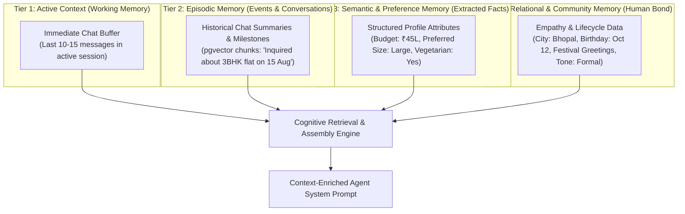
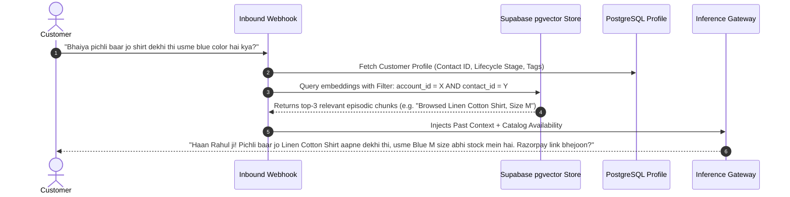
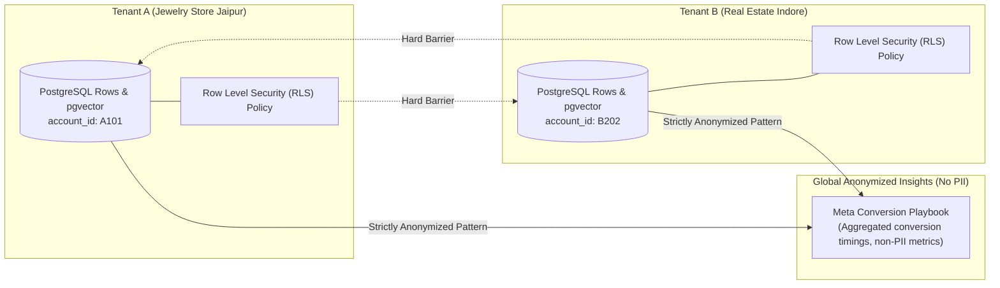

# 🧠 04. Multi-Tier Memory Architecture, RAG Learning & Tenant Privacy

This document defines the deep relational memory engine, vector RAG retrieval, continuous learning loops, and strict multi-tenant privacy boundaries in Vismart AI SaaS.

---

## 🏛️ 1. Multi-Tier Memory Taxonomy

Vismart agents do not suffer from amnesia. They maintain a 4-tier cognitive memory model:

---

## 🔍 2. Two-Stage RAG & Vector Retrieval Pipeline

When a customer messages the WhatsApp bot or web widget, the memory engine executes a high-speed (<150ms) context injection pipeline:

### Technical Implementation Standards:
- **Vector Storage:** Supabase `pgvector` with HNSW (Hierarchical Navigable Small World) index for sub-10ms search over millions of chunks.
- **Embedding Generation:** Compact, cost-effective embeddings (e.g., `text-embedding-3-small` or local BGE embeddings via LiteLLM).
- **Background Memory Condensation:** When a chat session closes, an asynchronous background worker condenses the dialogue into 1 semantic summary chunk and updates extracted profile tags.

---

## 🔒 3. Strict Multi-Tenant Privacy & Data Isolation

Data privacy is non-negotiable. Vismart operates under a **Zero-Leakage Guarantee**:

### Privacy Rules:
1. **Row Level Security (RLS) Enforcement:** Every vector search query MUST include a hard SQL predicate `WHERE account_id = auth.account_id()`. No agent can ever query outside its tenant boundary.
2. **No Model Training on Private Tenant Data:** Customer conversations, contact numbers, and private catalogs are NEVER sent to third parties for fine-tuning or shared model training.
3. **Global Learning Abstraction:** Only abstract structural heuristics (e.g., *"Prompting with urgency 24 hours after pricing inquiry yields 22% higher response"*) are recorded in global best-practice playbooks. Zero PII, phone numbers, or private pricing are ever stored globally.

---

## 🗑️ 4. Data Ownership, Export & Right-to-be-Forgotten (GDPR / DPDP)

- **1-Click Export:** Business owners can export their entire customer list, chat history, and vector embeddings in standard JSON / CSV format at any time.
- **Permanent Deletion:** When an account or contact requests deletion, a cascading database purge deletes all relational records, message logs, and vector embeddings permanently.
- **Audit Logs:** Every export and purge action is permanently logged in the tenant's security audit register.
