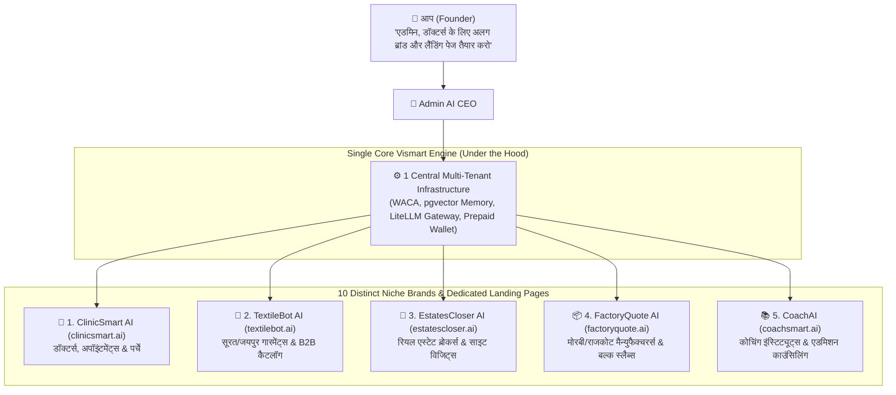

# 👑 05. Founder's Private AI CEO & Multi-Brand Vertical Generator

> *"एक ही प्रोडक्ट कोर से हम 10 अलग-अलग कंपनियां/ब्रांड्स चला सकते हैं! मैं एडमिन में AI CEO से बोलूँगा: 'डॉक्टर्स के लिए अलग लैंडिंग पेज और ब्रांड बनाओ', 'सूरत टेक्सटाइल के लिए अलग बनाओ', 'रियल एस्टेट के लिए अलग बनाओ' — AI CEO तुरंत उनके लिए अलग कस्टम डोमेन, कस्टमाइज्ड लैंडिंग पेज और इंडस्ट्री एजेंट तैयार करके लाइव कर देगा।"*  
> — **फाउंडर, Vismart AI SaaS** [Founder Confirmed]

---

## 🚀 1. "1 Core Engine $\to$ 10 Niche Brands" (The Multi-Vertical Empire)

मार्केटिंग का सबसे बड़ा नियम है: **"अगर आप सबको सब कुछ बेचेंगे, तो कोई नहीं खरीदेगा। लेकिन अगर आप डॉक्टर को डॉक्टर का सॉफ्टवेयर बेचेंगे, तो वह तुरंत खरीदेगा!"**

---

## 🎛️ 2. यह एडमिन से कैसे काम करेगा? (Zero Technical Work for Founder)

1. **फाउंडर का 1-लाइन कमांड:**
   - आप AI CEO से चैट में बोलेंगे:  
     *"Bhai, Indore aur Jaipur ke Doctors ke liye alag landing page aur brand ready karo. Monthly fee 3,999 aur ClinicSmart domain add karo."*
2. **AI CEO का ऑटोमैटिक एक्शन:**
   - **थीम और कंटेंट:** मेडिकल/क्लिनिक की भाषा, फोटो और टेस्टिमोनियल्स के साथ लैंडिंग पेज तैयार करेगा।
   - **कस्टम डोमेन मैपिंग:** `clinicsmart.ai` या `doctor.vismart.ai` से ऑटो-लिंक करेगा (फ्री SSL)।
   - **स्पेशलाइज्ड एजेंट एक्टिवेशन:** 'क्लिनिक अपॉइंटमेंट & प्रिस्क्रिप्शन एजेंट' को डिफ़ॉल्ट एजेंट बनाएगा।
   - **फाउंडर को 1-टैप प्रीव्यू:** *"भाई, डॉक्टर्स के लिए ClinicSmart AI लैंडिंग पेज तैयार है। [प्रीव्यू देखें] | [1-Click Go Live]"*

---

## 🏆 3. इस मॉडल के 4 विस्फोटक बिजनेस फायदे

1. **10x ज्यादा कन्वर्जन (Niche Authority):**  
   जब कोई डॉक्टर `ClinicSmart.ai` पर जाएगा, तो उसे लगेगा यह खास डॉक्टरों के लिए ही बनी कंपनी है। वह तुरंत ₹4,000-₹10,000 देगा।
2. **अलग-अलग ऐड्स और कैंपेन की आजादी:**  
   आप फेसबुक/गूगल पर अलग-अलग ऐड्स चला सकते हैं:
   - डॉक्टरों को दिखाओ: `ClinicSmart.ai`
   - कपड़ा व्यापारियों को दिखाओ: `TextileBot.ai`
   - बिल्डर्स को दिखाओ: `EstatesCloser.ai`
3. **कम लागत, 10 गुना साम्राज्य:**  
   10 अलग कंपनियां बनाने के लिए 10 अलग डेवलपर्स या 10 अलग सर्वर नहीं चाहिए। बैकएंड में हमारा **वही 1 Vismart सिस्टम** रहेगा!
4. **फ्यूचर में अलग-अलग ब्रांड्स को बेचना (Exit/Valuation):**  
   भविष्य में अगर कोई कंपनी सिर्फ हमारे "Real Estate AI Brand" को 5 करोड़ में खरीदना चाहे, तो हम उसे आसानी से अलग भी कर सकते हैं।

---

## 🔒 स्टेटस और सिंक्रोनाइज़ेशन रिपोर्ट

- **दस्तावेज़ अपडेटेड:**
  - [`docs/vision/05_OWNER_CEO_AGENT_ARCHITECTURE.md`](file:///C:/Users/hp/.gemini/antigravity/scratch/wacrm/docs/vision/05_OWNER_CEO_AGENT_ARCHITECTURE.md) (वर्जन 4.0.0 — Multi-Brand Vertical Generator)
  - [`docs/vision/10_DECISIONS_REGISTER_AND_OPEN_QUESTIONS.md`](file:///C:/Users/hp/.gemini/antigravity/scratch/wacrm/docs/vision/10_DECISIONS_REGISTER_AND_OPEN_QUESTIONS.md) (`Founder Confirmed` के रूप में रजिस्टर्ड)
