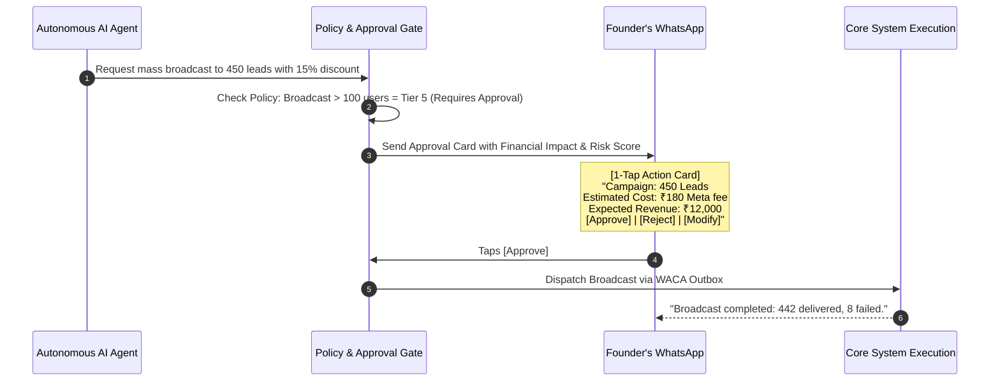

# 🛡️ 06. Permissions, Autonomy Tiers & Human Approval Governance

This document establishes the safety boundaries, 7-tier autonomy levels, immutable action ledger, and human-in-the-loop approval protocols across Vismart AI SaaS.

---

## 🚦 1. The 7-Tier Autonomy Matrix

To ensure that autonomous agents provide maximum value without causing unintended financial or operational harm, every AI action is classified into one of 7 permission tiers:

| Tier | Autonomy Level | Description | Example Actions | Autonomous Execution? |
|---|---|---|---|:---:|
| **Level 0** | **Observe & Log** | Passive telemetry, log ingestion, health checks. | Querying conversation volume, reading CPU load. | ✅ **YES** |
| **Level 1** | **Suggest** | Formulates strategic tips or operational advice. | Proposing a 10% discount campaign to the founder. | ✅ **YES** (Output only) |
| **Level 2** | **Prepare & Stage** | Creates draft resources in draft/inactive state. | Creating a draft Meta template or discount coupon. | ✅ **YES** (Staged only) |
| **Level 3** | **Sandbox Test** | Executes actions inside a test/simulator environment. | Simulating 50 test chats on a new prompt version. | ✅ **YES** (Isolated) |
| **Level 4** | **Preauthorized** | Low-risk actions pre-approved within defined limits. | Sending payment links $\le$ ₹10,000; answering FAQs. | ✅ **YES** (Bounded) |
| **Level 5** | **Approval Required**| High-impact actions affecting money, users, or data. | Mass WhatsApp broadcast; issuing refunds; plan changes. | ⚠️ **APPROVAL REQ.** |
| **Level 6** | **Restricted / Sovereign**| Critical actions reserved exclusively for Founder/Owner. | Bank payout detail updates; tenant purge; kill-switch. | 🚫 **NEVER AUTO** |

---

## 👆 2. The 1-Tap Founder Approval Workflow

When an agent or AI CEO triggers a Level 5 action, it generates a structured approval proposal delivered directly to the founder's WhatsApp / Admin Dashboard:



---

## 📜 3. Immutable Action Ledger & Audit Trail

Every state-mutating action is recorded in the PostgreSQL `action_ledger` table with full cryptographic traceability:

```sql
-- Structure of Action Ledger Record
{
  "ledger_id": "act_89f3a1bc",
  "account_id": "acc_jaipur_clothing",
  "actor_type": "AI_AGENT", // "AI_AGENT" | "FOUNDER_CEO" | "HUMAN_OPERATOR"
  "actor_id": "agent_sales_closer_v2",
  "autonomy_tier": 4,
  "action_name": "generate_razorpay_link",
  "target_entity": "contact_9829012345",
  "payload": { "amount": 1499, "items": ["Cotton Kurti Blue - M"] },
  "policy_evaluation": { "passed": true, "max_limit": 5000 },
  "execution_status": "SUCCESS",
  "timestamp": "2026-10-03T17:15:00Z"
}
```

---

## 🛑 4. Emergency Kill-Switches & Human Takeover

1. **Instant Agent Kill-Switch:** A single toggle in the admin dashboard or via WhatsApp command (`/KILL_ALL_AGENTS`) immediately freezes all automated outbound messaging.
2. **Conversation-Level Human Takeover:** The moment a human operator opens a live chat and types a response, the AI is immediately muted for that specific session for 24 hours (or until explicitly resumed).
3. **Automated Sentiment Escalation:** If customer sentiment falls below negative threshold (e.g., abusive language, frustration), the AI automatically halts and alerts the merchant team.
