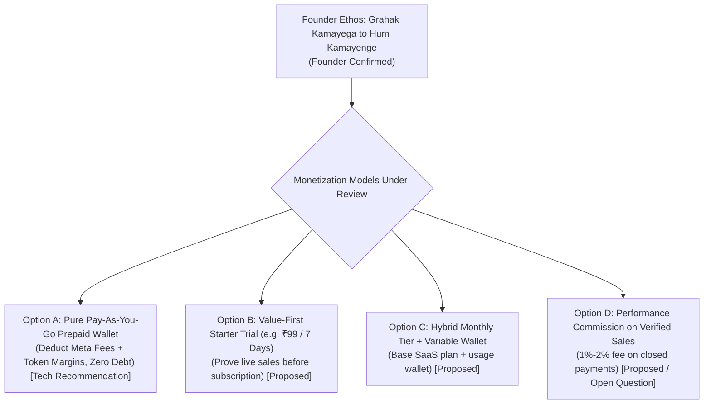
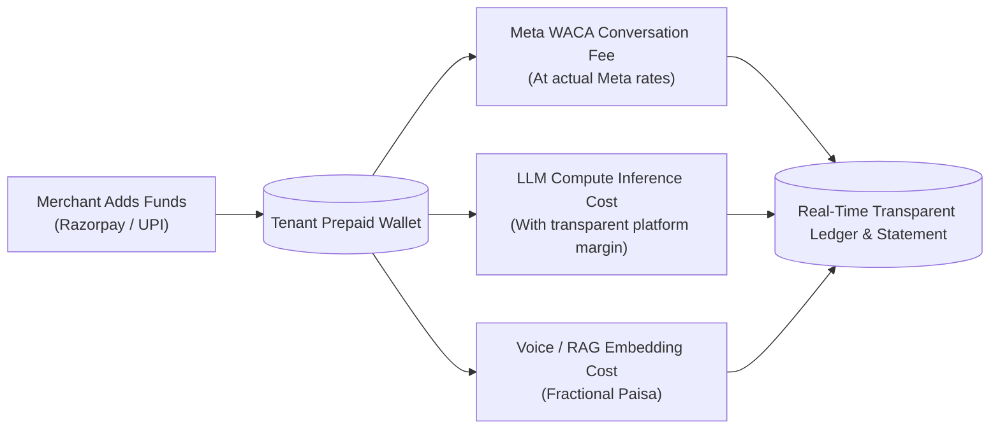

# 💳 07. Billing Economics, Transparent Wallet & Unit Margins

This document details the proposed financial models, wallet architecture, token margin optimization, and fair growth-sharing mechanics.

> [!NOTE]
> **GOVERNANCE STATUS:**  
> The core principle *"Grahak kamayega to hum kamayenge"* is `[Founder Confirmed]`. Specific pricing numbers (e.g. ₹99, ₹1,499, 1-2% commission) in this document are `[Proposed]` candidates requiring explicit Founder confirmation.

---

## 💰 1. The Proposed Multi-Tier Billing Models `[Proposed]`

---

## 🪙 2. The Transparent Prepaid Wallet Engine `[Technical Recommendation]`

### Wallet Operating Rules `[Technical Recommendation]`:
1. **Real-Time Atomicity:** Balance is deducted atomically using database stored procedures with unique idempotency keys.
2. **Zero Overdraft Guarantee:** If the wallet balance hits ₹0, the agent gracefully alerts the merchant; it never incurs negative debt.
3. **Merchant Daily Spend Caps:** Merchants can configure a maximum daily budget ceiling to prevent unexpected costs.
4. **Transparent Statement:** Invoices show an itemized breakdown of Meta WhatsApp fees, AI compute, and platform service.

---

## 📈 3. Multi-LLM Cost Optimization `[Technical Recommendation]`

To protect unit economics while keeping costs negligible for small businesses, Vismart implements hierarchical model routing:

| Workload Type | Candidate Model | Speed | Typical Cost / 1k Tokens | Purpose |
|---|---|---|---|---|
| **Simple FAQs & Triage** | Groq Llama 3.1 8B / Cerebras | Instant (<200ms) | Negligible | Fast, zero-friction answers |
| **Sales Closing & Negotiation** | Groq Llama 3.3 70B / Qwen | Fast (<600ms) | Low | High-converting sales dialogues |
| **Founder AI CEO & Strategy** | DeepSeek R1 / Gemini 2.0 Flash | Deep Reasoning | Moderate | Executive intelligence & agent generation |

---

## ❓ 4. Open Monetization Questions for Founder Review `[Open Question]`

1. **Trial Structure:** Should the starter trial be ₹99, ₹199, or free with limited credits?
2. **Performance Commission Feasibility:** Should commission be restricted only to transactions where the AI generates a verifiable Razorpay payment link?
3. **Wallet Auto-Recharge:** Should merchants have an optional auto-recharge toggle (e.g., auto-add ₹500 when wallet drops below ₹100)?
