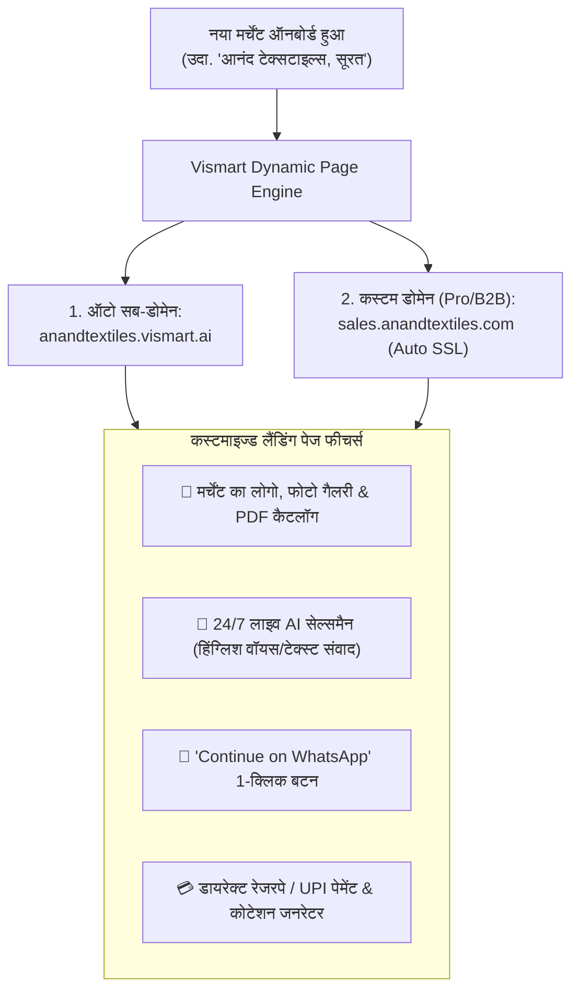
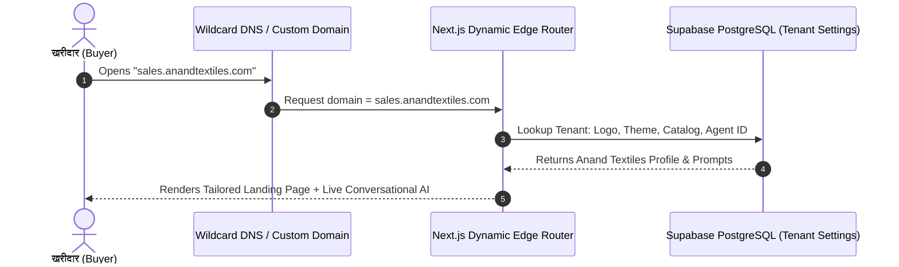

# 🌐 08. Omnichannel Integrations, Dynamic Custom Landing Pages & Gateway Routing

> *"हम हर क्लाइंट को उनके अपने डोमेन या सब-डोमेन पर एक अलग कस्टमाइज्ड लैंडिंग पेज और 24/7 लाइव AI चैटबॉट भी दे सकते हैं — ताकि जिनके पास वेबसाइट नहीं है उन्हें तुरंत पूरी वेबसाइट+AI मिल जाए, और बड़े ब्रांड्स अपने खुद के डोमेन (chat.theirbrand.com) पर चला सकें।"*  
> — **फाउंडर, Vismart AI SaaS** [Founder Confirmed]

---

## 🚀 1. ऑटो-जनरेटेड डेडिकेटेड लैंडिंग पेज + AI चैटबॉट (The 1-Minute Micro-Site Engine)

भारत के 80% छोटे व्यापारियों और B2B मैन्युफैक्चरर्स के पास कोई अच्छी, मॉडर्न वेबसाइट नहीं होती। Vismart उन्हें **1 मिनट में लाइव AI लैंडिंग पेज** बनाकर देता है:

---

## 🏆 2. यह फीचर क्लाइंट्स को क्यों दीवाना बना देगा? (Massive Sales Magnet)

1. **वेबसाइट का झंझट खत्म (Instant Professional Presence):**
   - व्यापारी को वेबसाइट बनवाने के लिए किसी डेवलपर को ₹20,000-₹50,000 देने की जरूरत नहीं।
   - Vismart में कैटलॉग डालते ही उनका **प्रीमियम मोबाइल-रिस्पॉन्सिव लैंडिंग पेज + AI सेल्समैन** तुरंत लाइव हो जाता है।
2. **विज्ञापन से आने वाले ट्रैफिक का 10x कन्वर्जन:**
   - जब मर्चेंट फेसबुक, गूगल या इंस्टाग्राम पर ऐड चलाएगा, तो ट्रैफिक इस लैंडिंग पेज (`sales.brand.com`) पर आएगा।
   - AI ग्राहक का स्वागत करेगा, उत्पाद दिखाएगा, उसका व्हाट्सएप नंबर लेगा और डील क्लोज करने के लिए तुरंत व्हाट्सएप पर चैट ट्रांसफर कर देगा।
3. **व्हाइट-लेबल कस्टम डोमेन (Agency & Enterprise Power):**
   - बड़े ब्रांड्स और मैन्युफैक्चरर्स अपने मुख्य डोमेन को कनेक्ट कर सकते हैं: `quote.morbitiles.com` या `ai.sharmaclinics.com`।
   - ऑटोमैटिक फ्री SSL सर्टिफ़िकेट (Cloudflare for SaaS / Wildcard Routing)।

---

## 🛠️ 3. टेक्निकल आर्किटेक्चर (Zero Extra Server Cost)

हजारों क्लाइंट्स के लिए अलग-अलग कोड नहीं लिखना पड़ेगा; यह **सिंगल डायनेमिक मल्टी-टेनेंट इंजन** पर चलेगा:

---

## 📡 4. ओमनी-चैनल कनेक्टिविटी मैट्रिक्स

| चैनल | कैसे काम करेगा? | उपयोग का प्रकार |
|---|---|---|
| **कस्टम डोमेन लैंडिंग पेज** | `chat.client.com` या `client.vismart.ai` पर पूरा पेज + AI | वेब ट्रैफिक & गूगल/FB ऐड्स |
| **एम्बेडेड वेब विजेट (Script Tag)** | `<script src="https://cdn.vismart.ai/widget.js">` | जिनकी पहले से वेबसाइट है (Shopify/Wordpress) |
| **ऑफिशियल व्हाट्सएप (WACA)** | ऑफिशियल मेटा व्हाट्सएप क्लाउड API | मुख्य व्हाट्सएप नंबर पर 24/7 ऑटोमेशन |
| **गूगल शीट्स / CRM सिंक** | सभी लीड्स और ऑर्डर्स का रियल-टाइम सिंक | मर्चेंट का अपना प्राइवेट डेटा बैकअप |
