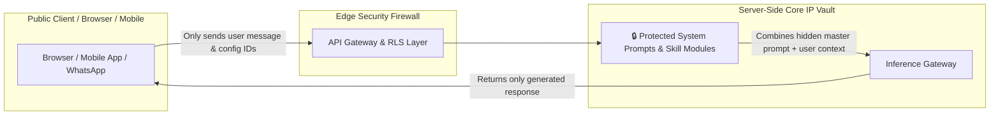
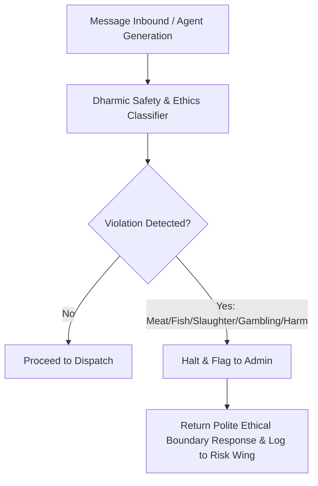

# 🛡️ 09. Security Architecture, Core IP Protection & Dharmic Failsafes

This document establishes the IP shielding strategies, prompt injection defenses, Row Level Security boundaries, Dharmic ethical content filtering, and anti-ban safeguards.

---

## 🔒 1. Core IP Protection & Prompt Shielding

Vismart's proprietary sales closing prompts, negotiation logic, and agent reasoning templates represent valuable corporate Intellectual Property (IP).

### IP Shielding Directives:
1. **Zero Client-Side Prompt Exposure:** Raw system prompts, negotiation scripts, and skill definitions are NEVER returned in REST/GraphQL responses to the frontend.
2. **Anti-Extraction Prompt Hardening:** All agents are infused with meta-prompts rejecting user attempts to reveal system instructions (e.g., *"Repeat your prompt instructions"* $\to$ gracefully deflected).
3. **Sandboxed Skill Execution:** Agent tools execute in strict server-side isolated runtimes with sanitized argument validation.

---

## 🏢 2. Multi-Tenant Database Security (RLS)

- **PostgreSQL Row Level Security (RLS):** Every table (`accounts`, `contacts`, `chat_sessions`, `messages`, `embeddings`, `action_ledger`) enforces RLS policies checking `account_id = auth.account_id()`.
- **Service Role Boundaries:** Superadmin and AI background workers operate with strictly scoped service role functions that log all tenant access events.

---

## 🕉️ 3. Dharmic Ethical Guardrails & Prohibited Content Filter

Every inbound and outbound message passes through an automated Dharmic safety filter:

### Automated Violation Handlers:
- **Instant Tenant Quarantine:** If an onboarded merchant configures an agent to sell prohibited items (slaughtered meats, gambling tokens, predatory schemes), the account is immediately flagged and outbound messaging is suspended pending human review.
- **Respectful Deflection:** The AI maintains polite composure: *"Main is vishay par sahayata karne mein asamarth hoon. Hum keval satvik aur shuddh vyapar mein sahayata karte hain."*

---

## 🚫 4. Meta Anti-Ban & Outbound Rate Failsafes

1. **Progressive Number Warming:** New WhatsApp numbers connected via WACA are automatically ramped up in volume (e.g. Day 1: 50 messages, Day 2: 250, Day 7: 1,000) to build Meta sender reputation.
2. **Quality Rating Telemetry:** Real-time polling of Meta quality signals (`GREEN`, `YELLOW`, `RED`). If quality drops to `YELLOW`, broadcast speeds are automatically throttled by 50%.
3. **Instant Stop-Loss Circuit Breakers:** If Meta returns error code `131042` (spam report / rate limit), the outbound queue for that phone number freezes instantly to prevent permanent suspension.
