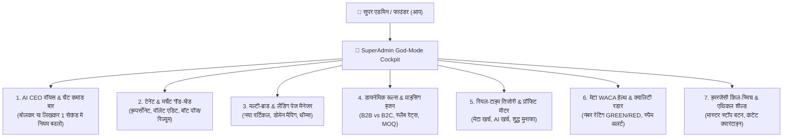
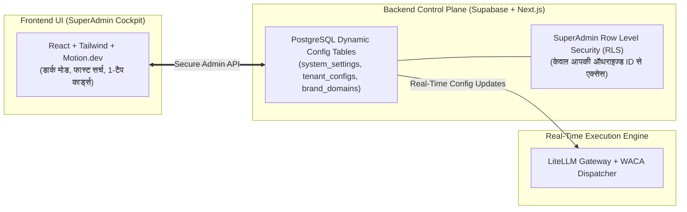

# 👑 11. SuperAdmin God-Mode Cockpit, Fine-Grained Controls & Implementation Spec

> *"एडमिन में हर छोटी-से-छोटी चीज का पूरा कंट्रोल मेरे हाथ में होना चाहिए—चाहे कोई भी नियम बदलना हो, किसी क्लाइंट का बॉट रोकना हो, नया ब्रांड लॉन्च करना हो या पाई-पाई के मुनाफे का हिसाब देखना हो। सब कुछ मेरे सुपर एडमिन से 1-क्लिक या चैट में संभव होना चाहिए।"*  
> — **फाउंडर, Vismart AI SaaS** [Founder Confirmed]

---

## 🏛️ 1. सुपर-एडमिन कॉकपिट का सम्पूर्ण आर्किटेक्चर (Full Control Architecture)

सुपर-एडमिन पैनल कोई सामान्य डैशबोर्ड नहीं है। यह पूरे Vismart साम्राज्य का **"कमांड सेंटर (Master Cockpit)"** है, जो 7 मुख्य कंट्रोल मॉड्यूल्स में बंटा हुआ है:

---

## 🎛️ 2. सातों (7) कंट्रोल मॉड्यूल्स की बारीक कार्यप्रणाली (Granular Features)

### 📌 मॉड्यूल 1: AI CEO वॉयस & चैट कमांड बार (Top Floating Bar)
- **क्या करेगा:** आपको किसी मेन्यू के अंदर 10 क्लिक नहीं करने पड़ेंगे। आप सीधे हिंदी या अंग्रेजी में बोलेंगे:
  - *"सूरत टेक्सटाइल का मंथली प्राइस ₹5,000 से ₹6,000 कर दो"*
  - *"क्लाइंट 'आनंद ज्वैलर्स' के वॉलेट में ₹500 का बोनस क्रेडिट डालो"*
  - *"आज का कुल मेटा बिल और हमारा नेट प्रॉफिट कितना हुआ?"*
- **कार्यान्वयन:** AI CEO तुरंत डेटाबेस को अपडेट करेगा और स्क्रीन पर कन्फर्मेशन कार्ड दिखाएगा: `[Confirm Update]` | `[Undo]`.

---

### 📌 मॉड्यूल 2: टेनेंट & मर्चेंट गॉड-मोड (Tenant Management & Impersonation)
- **मर्चेंट की पूरी कुंडली:** हर व्यापारी का नाम, फोन, इंडस्ट्री (B2B/B2C), कनेक्टेड व्हाट्सएप नंबर, कुल चैट्स, लीड स्कोर, और वॉलेट बैलेंस।
- **गॉड-मोड 1-क्लिक बटन्स:**
  1. **`[Login As Merchant]` (Impersonate):** बिना मर्चेंट का पासवर्ड जाने 1-क्लिक में उसके डैशबोर्ड में जाकर देखना कि उसे क्या दिख रहा है।
  2. **`[Emergency Pause Bot]`:** अगर किसी मर्चेंट के बॉट में कोई गलत प्रॉम्प्ट चला गया है, तो 1 सेकंड में उसके AI को म्यूट करना।
  3. **`[Wallet Adjust]`:** किसी भी मर्चेंट के वॉलेट में सीधे पैसे जोड़ना या काटना (नोट्स के साथ)।
  4. **`[Custom Prompt Override]`:** किसी वीआईपी क्लाइंट के लिए बिना कोड बदले उसके AI में कस्टम नियम जोड़ना।

---

### 📌 मॉड्यूल 3: मल्टी-ब्रांड & वर्टिकल डोमेन मैनेजर (1-Click Brand Spawner)
- **नया ब्रांड जोड़ना:**
  - **ब्रांड का नाम:** (उदा. `ClinicSmart AI`)
  - **टारगेट इंडस्ट्री:** (डॉक्टर / क्लिनिक)
  - **कस्टम डोमेन:** `clinicsmart.ai` या `doctor.vismart.ai`
  - **कलर थीम & लोगो:** मेडिकल ब्लू / क्लीन व्हाइट
  - **डिफ़ॉल्ट एजेंट्स:** क्लिनिक अपॉइंटमेंट + प्रिस्क्रिप्शन एजेंट
- **रिजल्ट:** बटन दबाते ही 60 सेकंड में उस इंडस्ट्री के लिए नई वेबसाइट और बॉट लाइव!

---

### 📌 मॉड्यूल 4: डायनेमिक रूल्स & प्राइसिंग इंजन (Zero Hardcoding)
- **B2B बनाम B2C मोड स्विच:**
  - `B2B Mode On`: स्लैब प्राइसिंग (50 पीस = ₹400, 500 पीस = ₹300), मिनिमम आर्डर (MOQ = 50), GST 18%, ट्रांसपोर्ट भाड़ा विकल्प चालू।
  - `B2C Mode On`: यूनिट प्राइसिंग, रेजरपे इंस्टेंट पेमेंट लिंक, प्रीपेड वॉलेट।
- **मार्जिन और रेट कंट्रोल:**
  - प्रति चैट रेट बदलना (उदा. ₹1.50 प्रति चैट)।
  - मेटा मैसेज पर हमारा सर्विस मार्जिन (उदा. 30% या 50%) तय करना।

---

### 📌 मॉड्यूल 5: रियल-टाइम तिजोरी & प्रॉफिट मीटर (Financial Command Center)
- **लाइव वित्तीय डैशबोर्ड:**
  1. **कुल आमदनी (Gross Revenue):** ₹4,85,000 (वॉलेट रिचार्ज + B2B सेटअप फीस)
  2. **मेटा (WhatsApp API) का वास्तविक खर्च:** ₹18,400
  3. **AI LLM कंप्यूट खर्च (Groq/LiteLLM):** ₹3,200
  4. **हमारा शुद्ध लाभ (Net Profit):** **₹4,63,400 (95.5% ग्रॉस मार्जिन)**
- **कम बैलेंस वाली लिस्ट (Low Balance Watchlist):** जिन मर्चेंट्स का बैलेंस ₹100 से कम है, उनकी लिस्ट और 1-क्लिक व्हाट्सएप रिचार्ज रिमाइंडर भेजने का बटन।

---

### 📌 मॉड्यूल 6: मेटा WACA हेल्थ, क्वालिटी & स्पैम रडार
- **नंबरों की सेहत (Health Radar):** सभी कनेक्टेड व्हाट्सएप नंबरों की मेटा क्वालिटी रेटिंग:
  - 🟢 **GREEN (स्वस्थ):** 100% सामान्य गति।
  - 🟡 **YELLOW (चेतावनी):** गति 50% ऑटो-स्लो ताकि बैन न हो।
  - 🔴 **RED (खतरा):** तुरंत एडमिन को सायरन अलर्ट + ऑटो-पॉज।
- **मेटा टेम्प्लेट अप्रूवल सेंटर:** कौन से मैसेज टेम्प्लेट मेटा से अप्रूव हुए, कौन से रिजेक्ट हुए और रिजेक्शन का कारण क्या है।

---

### 📌 मॉड्यूल 7: मास्टर किल-स्विच & सात्विक सुरक्षा शील्ड (Emergency & Security)
- **🔴 मास्टर इमरजेंसी किल-स्विच (Red Button):** एक क्लिक में पूरे प्लेटफ़ॉर्म के सभी एजेंट्स का आउटबाउंड मैसेजिंग फ्रीज कर देना (यदि मेटा की तरफ से कोई बड़ा ग्लिच आए)।
- **सात्विक कंटेंट क्वारंटाइन:** अगर कोई व्यापारी मांस/मछली/जुआ या अनैतिक सामान बेचने के लिए बॉट बनाएगा, तो सिस्टम उसे तुरंत क्वारंटाइन (Quarantine) में डालकर आपके सामने समीक्षा के लिए लाएगा।
- **एक्शन लेजर (Immutable Audit Log):** किसने, कब, किस IP से, कौन सा नियम बदला — पूरी टाइमलाइन का पक्का रिकॉर्ड।

---

## 🛠️ 3. यह तकनीकी रूप से कैसे लागू (Implement) होगा?

1. **डेटाबेस स्तर (Database Layer):**  
   सभी सेटिंग्स `system_configs` और `tenant_settings` टेबल में JSONB फॉर्मेट में रहेंगी। जब आप कोई बदलाव करेंगे, तो वह 5 मिलीसेकंड में पूरे सिस्टम में लागू हो जाएगा।
2. **सिक्योरिटी (Bank-Grade RLS):**  
   सुपर-एडमिन पैनल केवल आपकी वेरीफाइड मास्टर आईडी से खुलेगा। कोई भी सामान्य यूजर या मर्चेंट इन टेबल्स को छू भी नहीं सकता।
3. **सिस्टम का ऑटो-रीलोड (Instant Propagation):**  
   जैसे ही आप एडमिन में कोई रेट या नियम बदलेंगे, AI एजेंट्स को रीस्टार्ट करने की जरूरत नहीं पड़ेगी; वे अगली चैट से नए नियमों के अनुसार बात करना शुरू कर देंगे।
