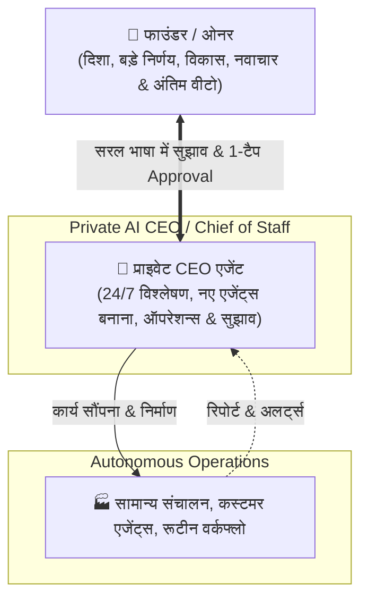

# 💖 Founder Intent, Operating Philosophy & Core Purpose of Vismart

> *"यह दस्तावेज़ Vismart AI SaaS के निर्माण के पीछे मेरे वास्तविक उद्देश्य, सोच, अपेक्षाओं और कार्य-संस्कृति का प्रामाणिक संकलन है। यहाँ मेरी कही हुई बातों और तकनीकी सुझावों को पूरी तरह अलग और पारदर्शी रखा गया है।"*  
> — **फाउंडर, Vismart AI SaaS**

---

## 📌 1. मैं Vismart क्यों बनाना चाहता हूँ? [Founder Confirmed]

1. **पारस्परिक समृद्धि और सच्चा ग्रोथ पार्टनर (Growth Partner Model):**
   - Vismart केवल एक सॉफ्टवेयर या चैटबॉट नहीं है। हम ग्राहक के ग्रोथ पार्टनर हैं।
   - हमारी सोच स्पष्ट है: *"ग्राहक कमाएगा, तो हम कमाएंगे।"* ग्राहक को यह स्पष्ट महसूस होना चाहिए कि Vismart की वजह से उसका काम हुआ है, नए ग्राहक आए हैं और उसकी वास्तविक कमाई बढ़ी है।
2. **ग्राहकों के जीवन, समाज और धर्म/कर्तव्य से जुड़ाव:**
   - हमारा कर्तव्य केवल पैसा कमाना नहीं है, बल्कि ग्राहक को खुशी देना, उनके सुख-दुख, शहर, घर, परिवार और जीवन की प्राथमिकताओं को समझना और उन्हें समाज व धर्म (सद्कर्म/कर्तव्य) के अच्छे कार्यों से जोड़ना है।
3. **आम व्यापारियों और क्रिएटर्स का सशक्तिकरण:**
   - एक छोटा व्यापारी या सोलो ऑपरेटर दिन भर के रूटीन संदेशों, पूछताछ और फॉलो-अप्स में न उलझे। तकनीक उनके लिए एक ऐसा शक्तिशाली, ईमानदार कर्मचारी बने जो 24/7 उनके व्यापार को संभाले।

---

## 🧭 2. AI के प्रति मेरा दृष्टिकोण: Tool नहीं, 'Working Partner' [Founder Confirmed]

- **सक्रिय कार्य साथी (Active Working Partner):** AI केवल एक सवाल का जवाब देने वाला कैलकुलेटर या चैट विंडो नहीं है। यह एक ऐसा सक्षम साथी है जो काम की जिम्मेदारी लेता है, योजना बनाता है और उसे पूरा करता है।
- **ईमानदार और सत्यवादी सलाहकार (Truth Over Flattery):** 
  - मुझे ऐसा AI चाहिए जो मेरी सोच और विजन को गहराई से समझे, लेकिन मेरी गलत धारणाओं या कमजोर योजनाओं पर आँख बंद करके सहमति न दे।
  - यदि मेरे किसी विचार में कोई तकनीकी, आर्थिक या व्यावहारिक कमी है, तो AI का पहला धर्म है कि वह पूरी ईमानदारी, सही डेटा और निष्पक्ष तर्क के साथ मुझे सही दिशा दिखाए।

---

## 👑 3. फाउंडर की भूमिका और संप्रभु नियंत्रण (Sovereignty & Focus) [Founder Confirmed]

1. **माइक्रो-मैनेजमेंट से मुक्ति:** मैं कंपनी का कर्मचारी बनकर दिन भर के छोटे-मोटे टेक्निकल ग्लिच, कोडिंग लॉग्स या रूटीन चैट हैंडलिंग में नहीं फंसना चाहता।
2. **फाउंडर का वास्तविक काम:** मेरा ध्यान उच्च-स्तरीय निर्णयों, नई बिज़नेस संभावनाओं, रणनीति, मार्केट विस्तार और सिस्टम की मूल आत्मा को बनाए रखने पर रहेगा।
3. **स्वायत्त लेकिन नियंत्रित संचालन (Autonomous Yet Sovereign):**
   - Vismart मेरे बिना भी सामान्य दैनिक ऑपरेशन्स सुचारू रूप से चलाने में सक्षम होना चाहिए।
   - लेकिन कोई भी महत्वपूर्ण, वित्तीय, नीतिगत या संस्थागत निर्णय मेरी प्रत्यक्ष अनुमति (सरल भाषा में अप्रूवल) के बिना कभी नहीं होगा।

---

## 🤖 4. प्राइवेट AI CEO एजेंट की भूमिका [Founder Confirmed]

मेरे एडमिन पैनल में एक शक्तिशाली, स्वायत्त **प्राइवेट AI CEO (Chief of Staff)** होगा:
1. **मार्केट और बिजनेस इंटेलिजेंस:** वह बाजार की मांग, आपूर्ति, ग्राहकों की जरूरतें और पैसे कमाने के नए तौर-तरीकों को समझेगा और मुझे बताएगा।
2. **एजेंट्स का निर्माण और प्रबंधन (Agent Factory Orchestrator):** वह जरूरत पड़ने पर खुद नए सब-एजेंट्स तैयार करेगा, उन्हें विशिष्ट कार्य सौंपेगा और उनकी कार्यप्रणाली पर नजर रखेगा।
3. **नियंत्रित ऑनबोर्डिंग (Controlled Growth):** वह मनमाने तरीके से असीमित यूजर्स को ऑनबोर्ड नहीं करेगा; जब तक हमारे पास संभालने की पूरी क्षमता न हो, तब तक एंट्री को नियंत्रित रखेगा।
4. **मुझसे सरल भाषा में संवाद:** वह तकनीकी जार्गन के बजाय सीधी, स्पष्ट भाषा में मुझे विकल्प देगा और मेरा अप्रूवल लेगा।

---

## 🛠️ 5. कस्टमर की स्वतंत्रता और नियंत्रण (Customer Sovereignty) [Founder Confirmed]

- **ग्राहक अपना AI खुद बनाए और सिखाए:** हर कस्टमर बिना किसी जटिल कोडिंग के अपने AI एजेंट को अपनी मर्जी से बना सके, उसे अपने व्यापार की बातें सिखा सके और अपने हिसाब से चला सके।
- **पूर्ण नियंत्रण और पारदर्शिता:** कस्टमर जब चाहे AI को रोक सके, बातचीत खुद संभाल सके और अपने डेटा पर पूरा मालिकाना हक रखे।
- **विश्वास और सुरक्षा:** कस्टमर का डेटा पूरी तरह निजी और सुरक्षित रहे। एक कस्टमर की गोपनीय जानकारी कभी दूसरे के पास न जाए।

---

## 📊 6. अपेक्षाओं का स्पष्ट वर्गीकरण (Founder Intent vs Proposals vs Dreams)

यहाँ मेरी वास्तविक बातों और तकनीकी प्रस्तावों को पारदर्शी रूप से अलग किया गया है:

### Category A: फाउंडर के मूल सिद्धांत [Founder Confirmed]
- Vismart एक 'ग्रोथ पार्टनर' है (*"ग्राहक कमाएगा तो हम कमाएंगे"*).
- AI केवल चैटबॉट नहीं, सक्षम वर्किंग पार्टनर है जो सच बोलता है.
- फाउंडर केवल बड़े विजन और दिशा पर ध्यान देगा, छोटे कामों में नहीं उलझेगा.
- प्राइवेट AI CEO मार्केट समझेगा, नए एजेंट्स बनाएगा और सरल भाषा में अप्रूवल लेगा.
- कस्टमर अपने AI को खुद बनाने और नियंत्रित करने के लिए स्वतंत्र होगा.
- सिस्टम फाउंडर की अनुपस्थिति में भी सामान्य ऑपरेशन्स संभाल सके, लेकिन महत्वपूर्ण फैसलों पर फाउंडर का वीटो रहेगा.
- विश्वास, प्राइवेसी और सुरक्षा में कोई समझौता नहीं.

### Category B: तकनीकी व व्यावसायिक प्रस्ताव [Proposed / Technical Recommendation]
*(यह टीम या सिस्टम द्वारा सुझाए गए प्रस्ताव हैं, जो फाउंडर के अंतिम निर्णय के अधीन हैं)*
- ₹99 का वैल्यू-फर्स्ट 7-दिवसीय ऑनबोर्डिंग ट्रायल `[Proposed]`
- पारदर्शी प्रीपेड वॉलेट आधारित पे-पर-यूज टोकन बिलिंग `[Technical Recommendation]`
- 7-टियर ऑटोनॉमी मैट्रिक्स (Level 0 से Level 6) `[Technical Recommendation]`
- Supabase `pgvector` HNSW आधारित मेमोरी आर्किटेक्चर `[Technical Recommendation]`
- ऑफिशियल WhatsApp Cloud API (WACA) का अनन्य उपयोग `[Technical Recommendation]`
- 1%–2% का परफॉरमेंस आधारित रेवेन्यू शेयर मॉडल `[Proposed]`
- दैनिक ऑनबोर्डिंग गति को 30–50 यूजर्स पर सीमित करना `[Proposed]`

### Category C: भविष्य की दूरदर्शी कल्पनाएं [Futuristic Aspirations]
- भारतीय भाषाओं और स्थानीय बोलियों में स्वाभाविक वॉयस-बेस्ड एजेंट इंटरेक्शन.
- व्यापारियों का स्वायत्त कोऑपरेटिव ग्रोथ नेटवर्क जहां AI आपस में B2B डिमांड-सप्लाई मैच करे.
- पूर्णतः स्वचालित मार्केट रिसर्च इंजन जो नई लोकल बिज़नेस ऑपर्च्युनिटीज खोजकर लाए.

---

## ❓ 7. अनसुलझे प्रश्न एवं फाउंडर के चिंतन बिंदु [Open Questions]

1. **ऑफलाइन कमाई में पार्टनरशिप सत्यापन:** जब मर्चेंट नकद (Cash) या निजी QR कोड पर डील क्लोज करे, तो पार्टनरशिप की गणना और विश्वास का क्या ढांचा हो?
2. **सहानुभूति और प्राइवेसी की सीमा:** कस्टमर की व्यक्तिगत जानकारी (शहर, परिवार, उत्सव) पूछते समय ग्राहक को हमेशा यह अपनत्व लगना चाहिए, कभी भी अनुचित दबाव नहीं.
3. **ऑनबोर्डिंग क्षमता की सटीक सीमा:** शुरुआती चरण में सिस्टम की गुणवत्ता बनाए रखने के लिए रोजाना कितने नए व्यापारियों को प्रवेश दिया जाए?
